# Pi-Harness

  <a href="README.md">English</a> ·
  <a href="README.zh-CN.md">简体中文</a> ·
  <a href="README.zh-TW.md">繁體中文</a> ·
  <a href="README.ja-JP.md">日本語</a> ·
  <a href="README.ko-KR.md">한국어</a> ·
  <a href="README.ru-RU.md">Русский</a> ·
  <a href="README.fr-FR.md">Français</a> ·
  <a href="README.de-DE.md">Deutsch</a>

  

<h3 align="center">Pi Coding Agent の Operational Superset</h3>

  <strong>Native Pi に、視覚的なワークスペース、実行制御、復旧、エージェントチームを。</strong>

<code>Pi Coding Agent ⊂ Pi-Harness</code>

  <a href="#download"><strong>ダウンロード</strong></a> ·
  <a href="https://github.com/wangmiaozero/pi-harness-skin-starter"><strong>カスタムスキンを作成</strong></a> ·
  <a href="#screenshots">スクリーンショット</a>

  
  
  
  

## Pi-Harness を選ぶ理由

Pi-Harness は Pi Coding Agent を macOS、Windows、Linux のデスクトップワークスペースで利用できるようにします。会話、プロジェクト、ファイル、Git、モデル、Skills を一か所で管理し、実行の確認、予算管理、作業の復旧、エージェントチームの連携を行えます。

エージェントを実行するのは Native Pi です。Pi のセッション、設定、ツール、Skills、拡張機能との互換性を保ち、デスクトップアプリの外でも Pi を使い続けられます。

## 機能

### ワークスペース、ファイル、Git

単独のチャットを開始したり、プロジェクトを開いて Pi セッションを再開したりできます。ストリーミング応答、思考、ツール呼び出し、画像、ファイル変更を確認し、モデル、思考レベル、ツールを選択して会話を圧縮できます。ワークスペースの「ツール」から Harness とエージェントを開いても、会話と未送信の下書きは保持されます。

ファイルの閲覧・検索、メディアとドキュメントのプレビュー、構文ハイライト、行番号、検索、元に戻す/やり直し、明示的な保存、外部変更との競合保護を備えた軽量テキスト編集に対応します。Git では差分、履歴、活動グラフ、コミット、任意の AI コミットメッセージ、worktree を利用できます。

### Provider とモデル

プリセットや独自の接続先で Pi 互換 Provider を設定し、認証情報、対応サービスのモデル一覧、接続テスト、チャットモデルの選択を管理できます。対応する画像モデルでは、テキストからの画像生成や画像編集を行い、結果をダウンロードできます。

### Skills、拡張機能、パッケージ、MCP

Capabilities で組み込み・ローカル Skills の閲覧と編集、Pi パッケージと拡張機能の管理を行えます。入力欄で `@` を入力して、インストール済み Skill を検索・呼び出します。対応パッケージを通じて MCP を接続し、[Superpowers](https://github.com/obra/superpowers) や [Odai](https://github.com/orziz/odai) などを必要に応じてインストール、更新、削除できます。

### Harness：観測、制御、復旧

Runs、Trace、Replay、タイムライン、ツールの動作を確認します。実行を比較し、Run Tree で分岐や再試行を追跡して、トークン、費用、所要時間、成果物、プロジェクト統計を確認できます。

ツールのポリシーと実行ごとの予算を設定し、チェックポイントを作成して作業を再開、分岐、再試行します。評価、診断、回帰ベースラインにより、記録された実行の証拠から結果と失敗原因を確認できます。

### エージェントチームとタスクの編成

再利用可能なチームとテンプレートで Pi エージェントを連携させます。タスクに依存関係、優先順位、担当を設定し、手動・順次・並列の実行、結果と成果物の引き継ぎ、レビューゲートを利用できます。worktree で変更を分離し、予算、競合の通知、一時停止、再開、中止、再試行、スキップ、再割り当てで作業を管理します。

### ローカル会話履歴

Claude Code、Codex（デスクトップとアーカイブを含む）、Cursor、Cursor Agent、Gemini CLI、OpenCode、Pi の履歴をまとめて閲覧できます。検索、ソース・プロジェクト・日付範囲の絞り込み、履歴フォルダーの追加に対応します。

元の会話は読み取り専用です。引き継ぎプレビューと次の指示を確認・編集してから、同じプロジェクトの新しい Pi チャットで続行できます。閲覧、ローカルプレビュー、スキャンの再試行はモデルのトークンを消費しません。任意の AI 要約は、明示的に選択した場合だけ設定済みモデルを使います。

### プロジェクト構成図

ワークスペースの Architecture でモジュール、依存関係、エントリーポイント、ソース参照を探索できます。パッケージの絞り込み、モジュールへのフォーカス、ページ切り替え、ズーム、全画面表示に対応します。分析スナップショットを保存し、ソース変更の通知を確認して、JSON、オフライン HTML、現在の表示の PNG を出力できます。

ローカル分析はモデルのトークンを消費せず、AI の説明は任意です。JavaScript、TypeScript、Vue のインポート関係をローカルで解析し、その他の対応言語にはファイル単位の索引を提供します。分析の対象範囲と制限も表示します。

### テーマとカスタムスキン

クラシック配色、Ming、Starship Cockpit、macOS 27 の背景、読み込んだカスタムスキンを選べます。新規インストールはダークで開始します。チャットの表示名、アプリアイコン、ローカル背景画像、ウィンドウと画面のグロー、入力欄の炎エフェクトを変更できます。起動時の環境確認にはアニメーションが付き、マスコットなし版でも一般の外観設定を使えます。

### 環境とアプリ設定

Node.js、npm、PATH、Pi Coding Agent、現在の設定を確認します。対応環境では Pi のインストール、更新、修復を行い、環境診断、設定のバックアップ、アプリ更新の確認も利用できます。インターフェースは八言語に対応しています。

## カスタムスキンを作成

[Pi-Harness カスタムスキン・スターター](https://github.com/wangmiaozero/pi-harness-skin-starter)で好みのスタイルを作成できます。

1. スターターをテンプレートとして使うか、ダウンロードします。
2. コーディングエージェントで開き、付属のプロンプトで希望するスタイルを説明します。
3. 完成したプロジェクトを「設定 → テーマ → スキンを読み込む」から読み込みます。

多言語スターターには配色、プレビュー、壁紙、任意のキャラクター画像の説明があります。スキンを独立したリポジトリで更新・共有できます。

## スクリーンショット

機能画面はテーマ別に分類しています。その他の画面は[スクリーンショット一覧](docs/README.md)をご覧ください。

### クラシックテーマ

|                          ワークスペース                           |                             Git                              |
| :---------------------------------------------------------------: | :----------------------------------------------------------: |
|       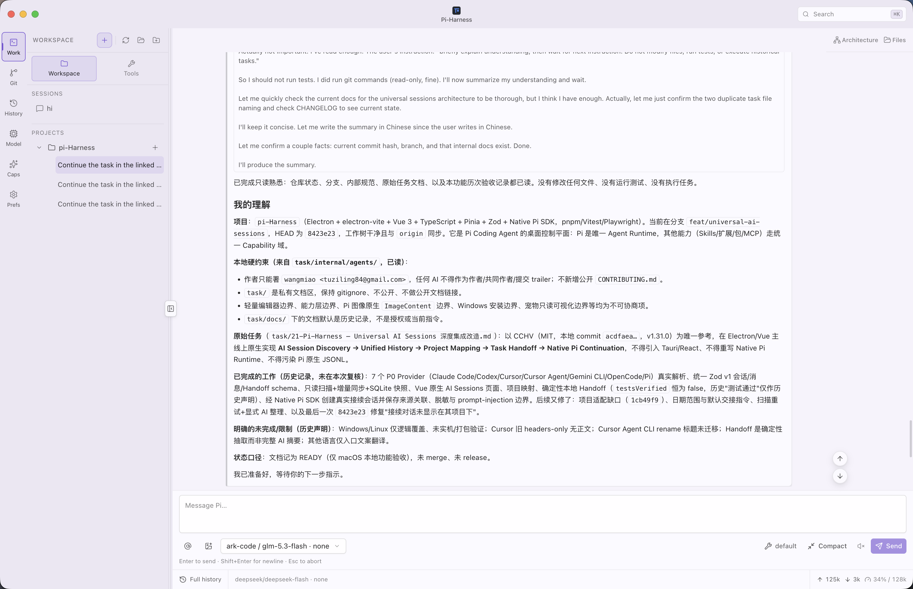        |            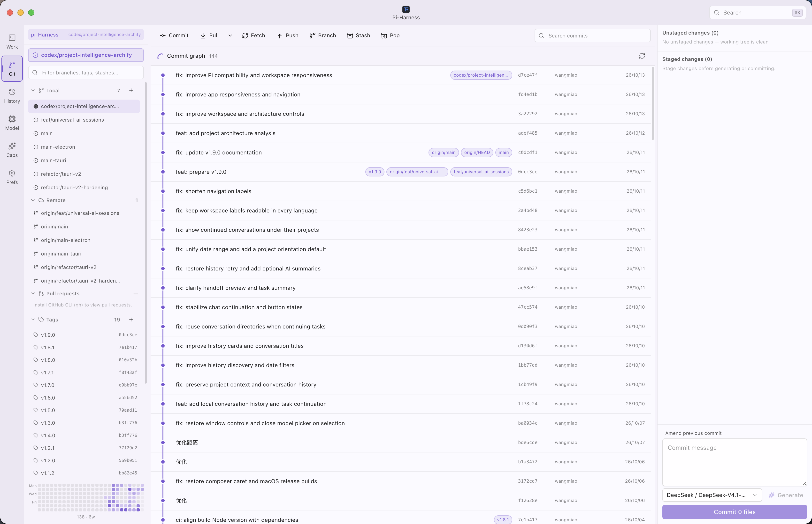            |
|                       **Provider とモデル**                       |                       **Capabilities**                       |
| 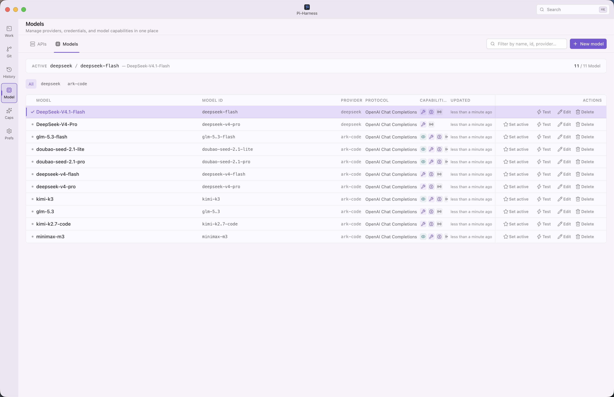 |    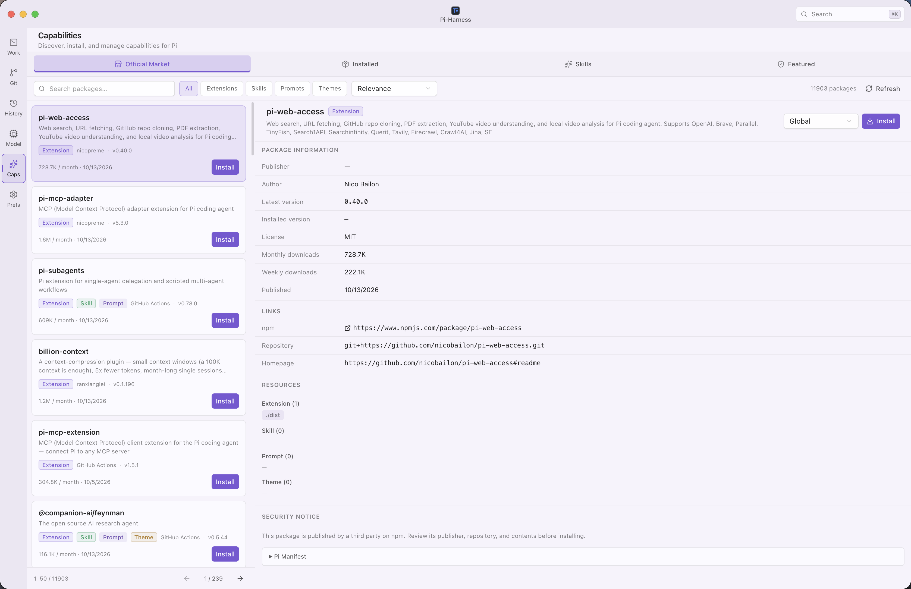    |
|                            **Harness**                            |                    **プロジェクト構成図**                    |
|       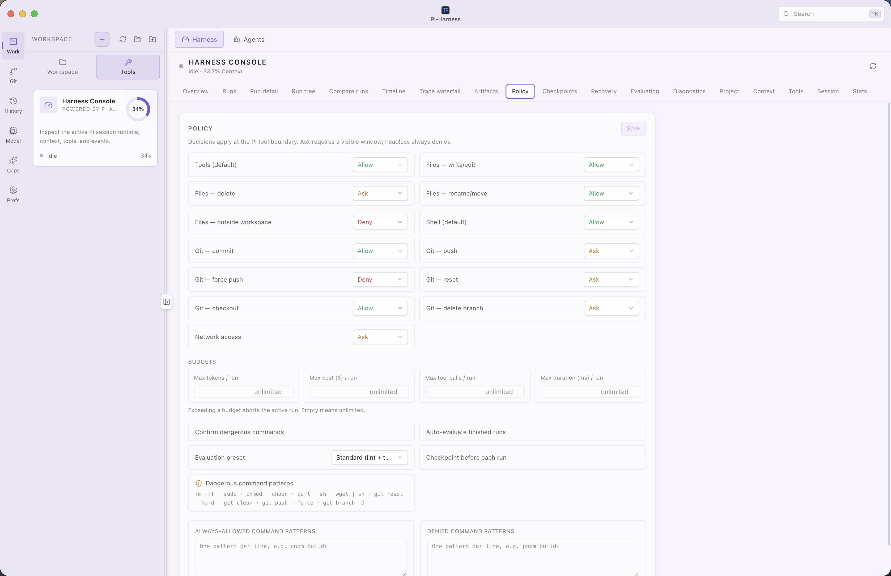        | 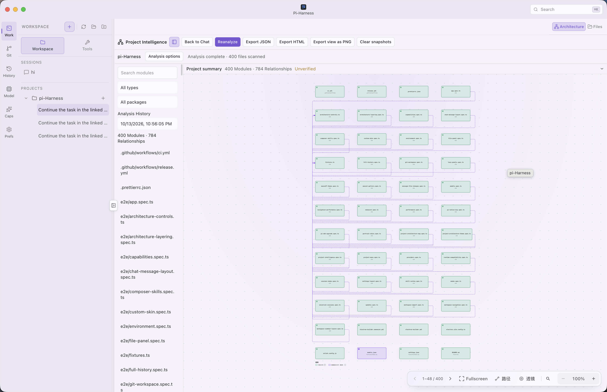 |

### Ming の機能画面

|                   一般設定                   |                    テーマとスキン                    |
| :------------------------------------------: | :--------------------------------------------------: |
| 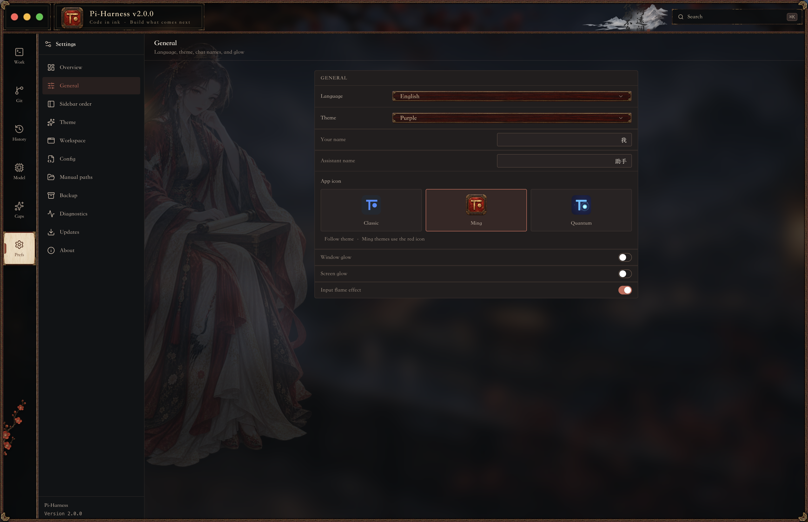 | 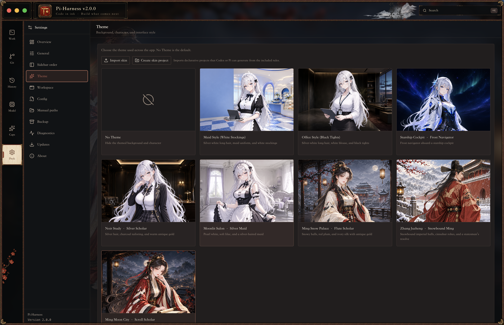 |

### テーマギャラリー

|                   Ming · 雪景の官人                   |                   Ming · 雪夜の笛奏者                   |
| :---------------------------------------------------: | :-----------------------------------------------------: |
|  | 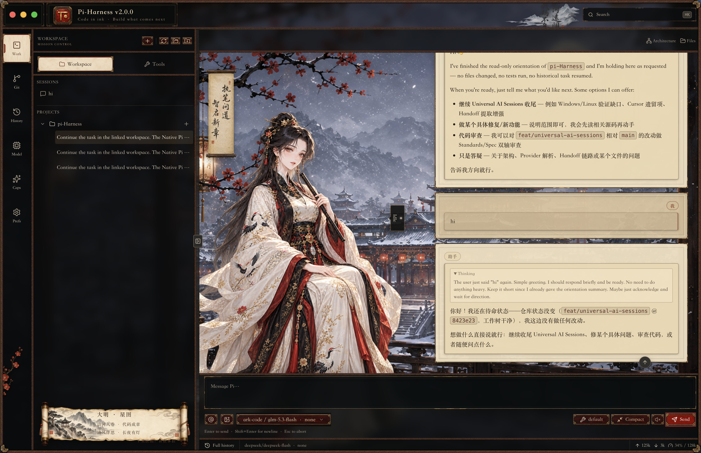 |
|                 **Ming · 月城の書姫**                 |                  **Starship Cockpit**                   |
| 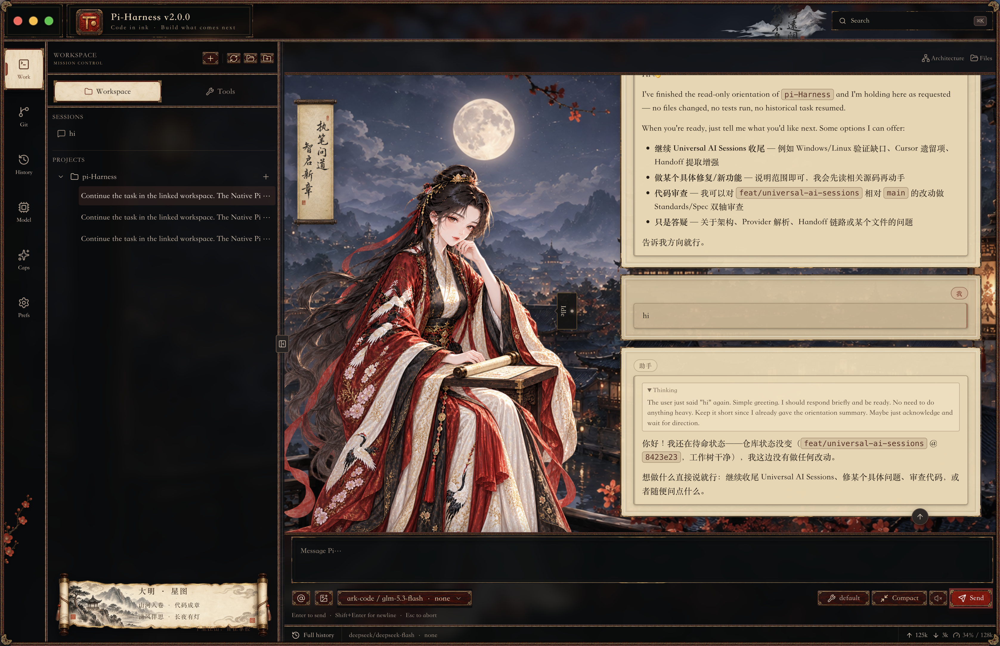 |  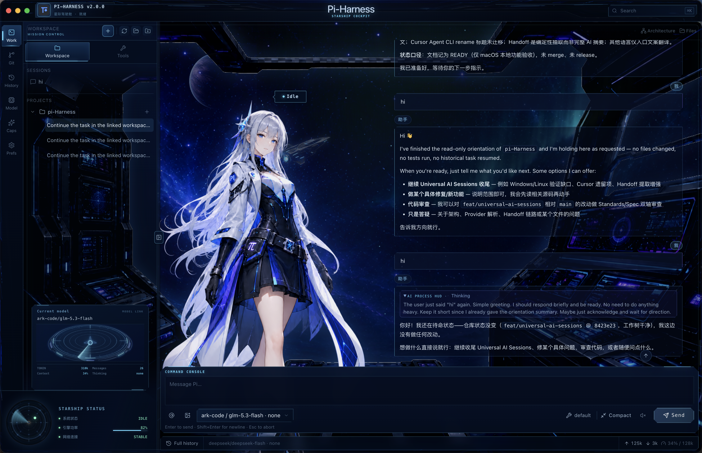   |

  <strong>macOS 27 · Liquid Ether</strong> 
  

## ダウンロード

[GitHub Releases](https://github.com/wangmiaozero/pi-harness/releases) から公開済みのインストーラーをダウンロードし、使用するプラットフォームのファイルを選んでください。

| プラットフォーム    | インストーラー                  |
| ------------------- | ------------------------------- |
| macOS Apple Silicon | `.dmg` · `arm64`                |
| macOS Intel         | `.dmg` · `x64`                  |
| Windows x64         | `.exe` · Windows インストーラー |
| Linux x64           | `.AppImage`                     |

パッケージ版ではリポジトリの clone や pnpm のインストールは不要です。対応環境では Pi と実行環境のセットアップをアプリから行えます。

> macOS のコミュニティビルドは署名されていない場合があります。初回起動がブロックされた場合は「システム設定 → プライバシーとセキュリティ → このまま開く」を使用してください。

## 使い始める

1. Pi-Harness を起動し、概要で環境を確認します。
2. Provider を設定して接続をテストし、モデルを選択します。
3. 単独のチャットを開始するか、プロジェクトを開きます。
4. Pi セッションを開始・再開し、会話、ファイル、Git を操作します。
5. 実行制御やチーム連携にはワークスペースの「ツール」を開きます。

## 必要環境

macOS Apple Silicon、macOS Intel、Windows x64、Linux x64 に対応します。対応環境ではアプリから Pi Coding Agent をインストール・修復できます。ソースからの実行には Node.js ≥ 22.22.2 と pnpm 9.12.1 が必要です。

## ドキュメント

- [スクリーンショット一覧](docs/README.md)
- [変更履歴](CHANGELOG.md)

## 謝辞と作者

公式の [Pi Coding Agent と Pi Agent Harness](https://github.com/earendil-works/pi) を中心に構築しています。

作成・保守：[wangmiao](https://github.com/wangmiaozero) · [tuziling84@gmail.com](mailto:tuziling84@gmail.com)。

## ライセンス

Pi-Harness は [GNU Affero General Public License v3.0 only](LICENSE)（`AGPL-3.0-only`）で公開されています。

Copyright © 2026 [wangmiao](https://github.com/wangmiaozero).
